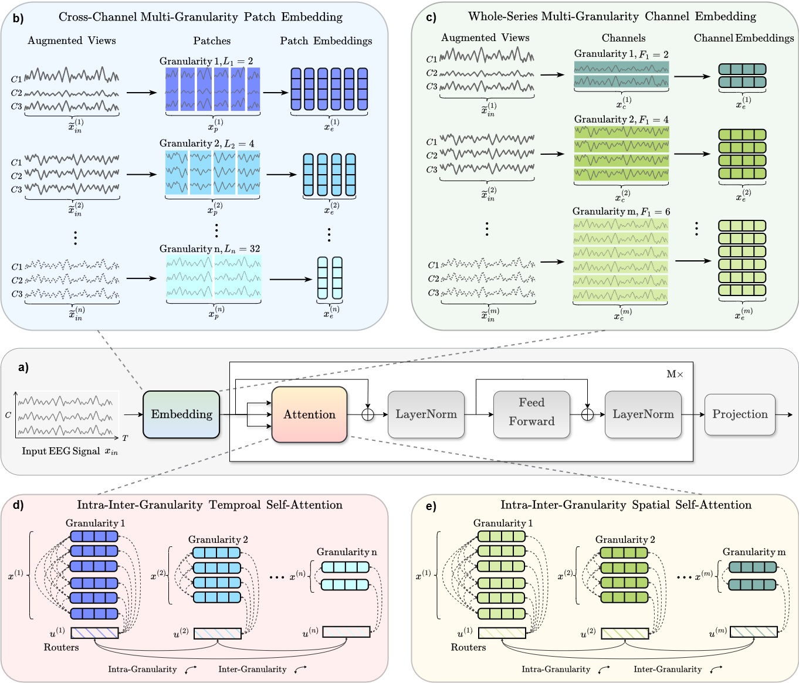
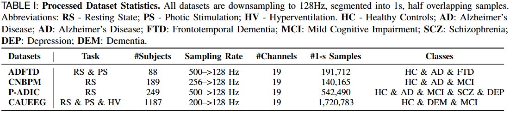

# ADformer: A Multi-Granularity Spatial-Temporal Transformer for EEG-Based Alzheimer Detection

#### Authors: 
#### [Yihe Wang](https://scholar.google.com/citations?user=1JRRcVkAAAAJ&hl=en), [Nadia Mammone](https://scholar.google.com/citations?user=JChtCEMAAAAJ&hl=it), [Darina Petrovsky](https://scholars.duke.edu/person/darina.petrovsky),
####  [Alexandros T. Tzallas](https://scholar.google.com/citations?user=Jrpqo_QAAAAJ&hl=en), [Francesco C. Morabito](https://scholar.google.com/citations?user=CRNR5KQAAAAJ&hl=en), [Xiang Zhang](http://xiangzhang.info/)(xiang.zhang@charlotte.edu)

#### ADformer Paper: [Preprint](https://arxiv.org/abs/2409.00032v2)


## Overview of ADformer

This repository contains the description of 4 datasets and the code of the ADformer method for the paper 
*ADformer: A Multi-Granularity Spatial-Temporal Transformer for EEG-Based Alzheimer Detection*. 
In this paper, we propose a novel multi-granularity spatial–temporal transformer 
designed to capture both temporal and spatial features from raw EEG signals, enabling effective end-to-end representation learning. 
Our model introduces multi-granularity embedding strategies across both spatial and temporal dimensions, 
leveraging a two-stage intra–inter granularity self-attention mechanism 
to learn both local patterns within each granularity and global dependencies across granularities. 
We evaluate ADformer on 4 large-scale datasets comprising a total of 1,713 subjects, 
representing one of the largest corpora for EEG-based AD detection to date, 
under a cross-validated, *subject-independent* setting. 
Experimental results demonstrate that ADformer consistently outperforms existing methods, 
achieving subject-level F1 scores of 92.82%, 89.83%, 67.99%, and 83.98% on the 4 datasets, respectively, 
in distinguishing AD from healthy control (HC) subjects.


## Details of ADformer


**a)** Workflow. 
**b)** For the $i$-th patch length $L_i$ denoting granularity $i$ and input sample $x_{\text{in}}$, 
we apply data augmentation to generate the augmented view $x_{\text{in}}^{(i)}$ 
and segment this view into cross-channel non-overlapping patches $x_{\text{p}}^{(i)}$. 
These patches are mapped into latent space and are combined with granularity and positional embeddings 
to produce the final patch embedding $x^{(i)}$. 
**c)** For the $j$-th scaled channel number $F_j$ denoting granularity $j$ and input sample $x_{\text{in}}$, 
we apply data augmentation to generate the augmented view $x_{\text{in}}^{(j)}$. 
The channel-wise positional embedding is added to the transposed augmented input 
$(x_{\text{in}}^{(j)})^{\mathsf{T}}$ to get $x_{\text{trans}}$ 
and a linear projection is applied to scale up the channel number. 
Finally, the entire series of channels is mapped into latent space and combined with the granularity embedding 
to produce the final channel embedding $x^{(j)}$. 
**d)** and **e)** We compute intra-granularity self-attention, 
which captures features within individual granularities, and inter-granularity self-attention, 
allowing for the exchange and learning of information across different granularities. 
A router mechanism is employed during inter-granularity self-attention to reduce time and space complexity.


## Datasets

### a) Raw Data Selection
We select 4 large-scale AD datasets by reviewing EEG-based AD detection papers published between 2018 and 2024.
They are
[ADFTD-RS](https://openneuro.org/datasets/ds004504/versions/1.0.8),
[ADFTD-PS](https://openneuro.org/datasets/ds006036/versions/1.0.5),
CNBPM,
[P-ADIC](https://datadryad.org/dataset/doi:10.5061/dryad.8gtht76pw), and
[CAUEEG](https://github.com/ipis-mjkim/caueeg-dataset). 
Note that ADFTD-RS and ADFTD-PS are two subsets of the same dataset ADFTD, 
where RS and PS denote resting-state and photic stimulation EEG data, respectively.
We combine these two subsets into one dataset, referred to as ADFTD in the paper.
The CNBPM dataset is the private dataset used in the classical [paper](https://www.sciencedirect.com/science/article/abs/pii/S0925231218311524) in EEG-based AD detection.
The CAUEEG dataset requires access to be requested from the authors.

### b) Data Preprocessing
**1) Frequency Filtering.** We apply frequency filtering to each sample, ranging from 0.5Hz to 45Hz, to remove frequency bands that do not correspond to brain activities.
**2) Re-referncing.** We re-reference the EEG signals to the common average reference (CAR) or  the linked ear reference, depending on the original reference used in each dataset.
**3) Artifacts Removal.** We perform artifact removal using the [MNE-ICALabel](https://mne.tools/mne-icalabel/) package, which utilizes Independent Component Analysis (ICA) to identify and eliminate artifacts such as eye blinks, muscle movements, and heartbeats from the EEG signals
**4) Frequency Alignment.** In addition to channel alignment, we resample all datasets to a uniform sampling frequency of 128Hz, which is commonly used and preserves the key frequency bands (delta δ, theta θ, alpha α, beta β, gamma γ), while also reducing noise.
**5) Sample Segmentation.** For deep learning training, we segment the EEG trials within each subject into 1-second half-overlapping samples, which results in 128 timestamps per sample, as the sampling frequency is aligned to 128Hz.
**6) Standard Normalization.** After frequency filtering, we perform standard normalization on each sample, applied individually to each channel, to ensure that the data is centered and scaled consistently.

The 1)-4) steps are performed on subject/trial level, while the 6) steps are performed on sample level after sample segmentation step 5).
Some datasets have already been preprocessed by the original authors, 
such as manual artifacts rejection or re-referencing, so we skip the corresponding steps for those datasets.
Preprocessing files for each dataset are provided in `data_preprocess/` folder. Step 5) `load_data_by_ids` and 6) `normalize_batch_ts` is performed in the `data_provider/uea.py` file.


### c) Processed data

1) **Datasets Statistics.** The four datasets comprise a total of **1,713** subjects, **2,595,150** 1-s samples.
Download the raw data from the links above in Data Selection and run notebooks in the folder `data_preprocessing/` for each raw dataset to get the processed dataset.

2) **Datasets Folder Paths.** 
The folder for processed datasets has two directories: `Feature/` and `Label/`. 
The folder `Feature/` contains files named in the format `feature_ID.npy` files for all the subjects, where ID is the patient ID. 
Each`feature_ID.npy` file contains recordings belonging to the same subject and stacked into a 2-D array with shape [T, C], T denotes the total timestamps for a subject, and C denotes the number of channels. 
Notice that different subjects may have different numbers of recording length.
The folder `Label/` has a file named `label.npy`. This label file is a 2-D array with shape [N-subject, 2], where N-subject denotes the number of subjects. The first column is the subject's label(e.g., healthy or AD), and the second column is the subject ID, ranging from 1 to N-subject.
The processed data should be put into `dataset/128Hz/DATA_NAME/` so that each subject file can be located by `dataset/128Hz/DATA_NAME/Feature/feature_ID.npy`, and the label file can be located by `dataset/128Hz/DATA_NAME/Label/label.npy`.  

3) **Processed Datasets Download link.** The processed datasets can be manually downloaded at the following link: 
https://drive.google.com/drive/folders/18gOTJdmtQK4tQ1GcsB-adgpodC8k6P5I?usp=sharing.
Since CNBPM and CAUEEG are private or need permission to get access first, we do not provide the processed version of dataset in the folder. 
Users need to request permission to download the raw data on the CAUEEG official github link and preprocess it with the jupyter notebook we provided.


## Requirements  
  
The recommended requirements are specified as follows:  
* einops==0.4.0
* matplotlib==3.7.0
* numpy==1.23.5
* pandas==1.5.3
* patool==1.12
* reformer-pytorch==1.4.4
* scikit-learn==1.2.2
* scipy==1.10.1
* sktime==0.16.1
* sympy==1.11.1
* torch~=2.0.0
* tqdm==4.64.1
* natsort~=8.4.0
* mne==1.9.0
* mne-icalabel==0.7.0
* h5py==3.13.0
* pyedflib==0.1.40

The dependencies can be installed by:  
```bash  
pip install -r requirements.txt
```


## Run Experiments
Before running, make sure you have all the processed datasets put under `dataset/`. 
You can see the scripts in `scripts/` as a reference. 
You could also run all the experiments by putting scripts line by line the `meta_run_adformer.sh` file.
The gpu device ids can be specified by setting command line `--devices` (e,g, `--devices 0,1,2,3`). 
You also need to change the visible gpu devices in script file by setting `export CUDA_VISIBLE_DEVICES` (e,g, `export CUDA_VISIBLE_DEVICES=0,1,2,3`). 
The gpus specified by commend line should be a subset of visible gpus.


Given the parser argument `--method`,`--task_name`, `--model`, and `--model_id` in `run.py`, 
the saved model can be found in`checkpoints/method/task_name/model/model_id/`; 
and the results can be found in  `results/method/task_name/model/model_id/`. 
You can modify the parameters by changing the command line. 
The meaning and explanation of each parameter in command line can be found in `run.py` file.


## Acknowledgement

We want to thank the authors of the EEG datasets used in this paper for generously sharing their data. 
Their efforts and contributions have been invaluable in advancing the field of EEG and EEG-based Alzheimer’s Disease detection.